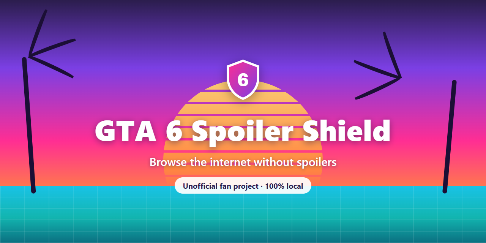
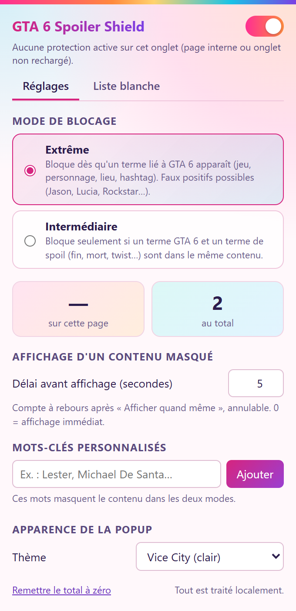
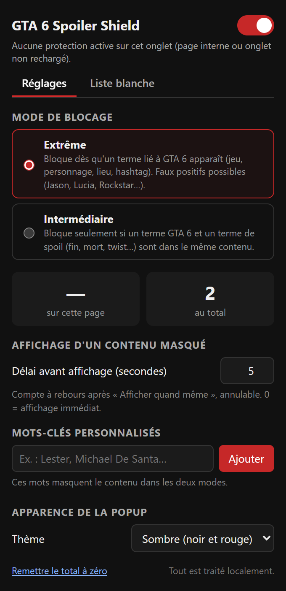
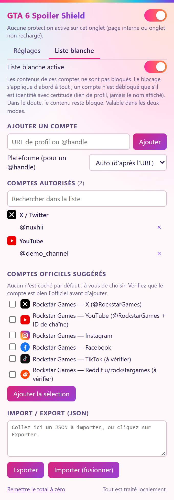
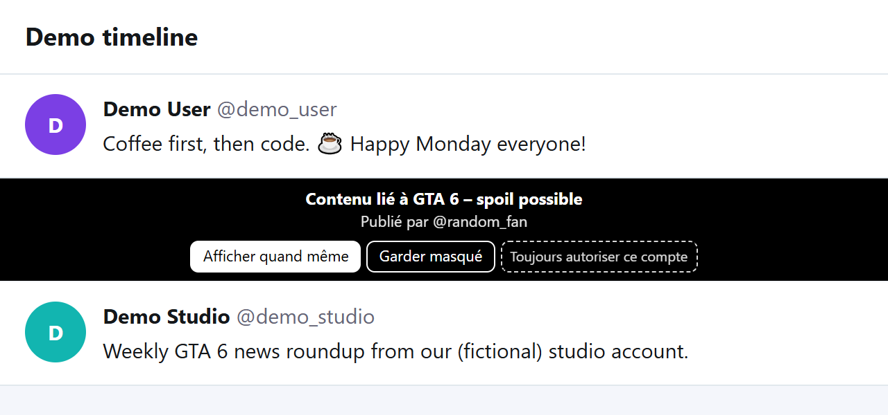
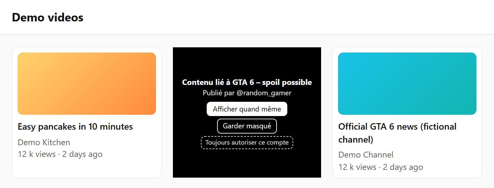
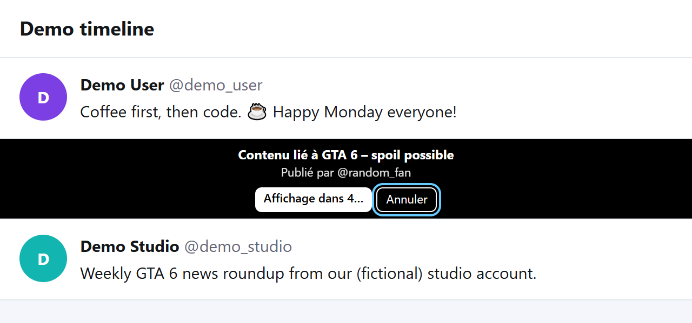

[🇬🇧 English](#english) | [🇫🇷 Français](#francais)

# 🛡️ GTA 6 Spoiler Shield

**Browse the internet without GTA 6 spoilers.**

  

## What it does

GTA 6 Spoiler Shield is a free browser extension that hides anything that could spoil **Grand Theft Auto VI** while you scroll. When a post, video or search result is about the game, it is covered by a black screen **before you can read it**, and you decide if and when to look.

It works on the websites where spoilers hide the most, and everything happens inside your browser: nothing is collected, nothing is sent anywhere.

> ℹ️ The extension's interface (black screen, popup) is currently in **French**. The keywords it detects cover 6 languages.

## Features

- 🚫 **Blocks spoilers** on X, YouTube (including Shorts), Reddit, TikTok, Instagram, Facebook and Google (including AI overviews and ads). Other sites, Threads included, are covered by a more general, less precise fallback.
- 🎚️ **2 blocking modes**: *Intermediate* (only real spoilers) and *Extreme* (anything about the game).
- 🌍 **Keywords in 6 languages** (French, English, Spanish, Italian, German, Portuguese) **plus your own custom keywords**.
- ⏳ **Safe reveal**: a black screen with a **5-second countdown** (adjustable) before showing a hidden post, so you never click by mistake. You can cancel at any time.
- ✅ **Account allowlist**: let trusted accounts through (for example an official studio channel), with a confirmation step and a safe-by-default design.
- 🎨 **Four themes**: *Sunset* (default, the look of the website) and its dark version *Sunset dark*, plus light *Vice City* and *Dark*.
- 🔒 **100% local**: no tracking, no data sent.

## Screenshots

<table>
  <tr>
    <td align="center"> Popup · Vice City (light)</td>
    <td align="center"> Popup · Dark</td>
    <td align="center"> Account allowlist</td>
  </tr>
</table>

  
  

A blocked post and a blocked video (demo pages, not real accounts)

   
  The countdown before revealing a hidden post (with a Cancel button)

> All screenshots use fictional demo pages and contain no real spoilers.

## How it works

1. **It reads what is on the page**: the text of posts, titles, captions, hashtags and the name of the account that posted.
2. **It looks for GTA 6 keywords** (the game, its characters and places, and spoiler words such as "ending" or "dies").
3. **It covers the post with a black screen** right away, and pauses and mutes any video inside it.
4. **You stay in control**: show it after a short countdown, keep it hidden, or allow that account for good.

## Blocking modes

| Mode | What it blocks | Best for |
| --- | --- | --- |
| **Intermediate** | Only content that mentions GTA 6 **and** a spoiler word (ending, death, twist…) in the same post. | People who still want to follow the game's news and only avoid real spoilers. |
| **Extreme** *(default)* | **Everything** about GTA 6: the game name, characters, places, hashtags. Some false positives are expected (a person named Jason, for example). | People who want zero risk until they have played the game. |

You can switch mode at any time from the extension popup.

## Installation

This extension is **free and distributed directly from GitHub**: there is no store and nothing to pay. You install it yourself in about a minute, in Chrome or any Chromium-based browser (Edge, Brave, Opera…).

1. **Download** the project: on the GitHub page, click the green **Code** button, then **Download ZIP**.
2. **Unzip** it into a folder you will **keep** (for example `Documents\GTA6SpoilerShield`). ⚠️ Chrome reads the extension from this folder every time it starts: **do not delete or move it** afterwards.
3. Open **`chrome://extensions`** in the address bar (Edge: `edge://extensions`).
4. Turn on **Developer mode** (switch at the top right).
5. Click **Load unpacked** and select the **`extension`** folder inside the unzipped folder, the one that **directly contains `manifest.json`** (not a parent folder).
6. Click the puzzle icon in the toolbar and **pin** the extension. Then **reload the tabs** that were already open (F5).

**To update:** download the new ZIP, replace the contents of your folder, click the circular arrow (↻) on the extension's card in `chrome://extensions`, then reload your tabs. Your settings are kept.

**Good to know**
- When Chrome starts, it may show *"Disable developer mode extensions"*. This is normal for any extension installed this way: close the message or choose to keep it. Do not click *Disable*.
- It works the same as a store extension: it runs every time you open the browser.
- Firefox and Safari are not supported (Chromium-based browsers only).

## Privacy

- **Nothing is collected and nothing is sent over the Internet.** There is no server, no analytics, no tracking.
- Everything is processed **inside your browser**.
- Your settings (mode, keywords, allowlist) are saved with the browser's own storage. If you have Chrome sync turned on, Chrome may sync them between your devices; the extension itself never sends them anywhere.

## FAQ

**It hides things that are not spoilers. Why?**
*Extreme* mode is strict on purpose: any mention of the game is hidden. Switch to *Intermediate* in the popup to hide only real spoilers, or allow the account that posted it.

**How do I let an account through?**
Two ways. On a black screen, click **"Toujours autoriser ce compte"** and confirm. Or open the popup, go to the **"Liste blanche"** tab and paste the account's profile link (or its @handle). If the account cannot be identified with certainty, the content stays hidden, on purpose.

**How do I add a word to hide?**
In the popup, type it in **"Mots-clés personnalisés"** and click **"Ajouter"**. It works in both modes. Developers can also edit `keywords.js`.

**How do I turn it off for a moment?**
Use the switch at the top of the popup. You can also pause only the allowlist with the switch in the "Liste blanche" tab.

**Nothing gets blocked on a page I just opened or after an update.**
Reload the tab (F5). Chrome does not update the extension in tabs that were already open.

## Contributing

Contributions are welcome!

- 🐞 **Report a bug or a missing site**: open a GitHub issue and tell us the website and what you expected. Please do not paste real spoilers: describe them instead.
- 🔤 **Suggest keywords or a new language**: see [`KEYWORDS.md`](KEYWORDS.md) for the full list and how to add a word or a language (`keywords.js`), then open a pull request.
- 🧑‍💻 **Technical documentation** (architecture, how each site is handled, tests, limits): [`README_MAX.md`](README_MAX.md) *(in French)*.

## License

Released under the [MIT License](LICENSE).

## Disclaimer

This is an **unofficial fan project**. It is **not affiliated with, endorsed by or connected to Rockstar Games or Take-Two Interactive**. *Grand Theft Auto*, *GTA* and *GTA VI* are trademarks of their respective owners. No official logo or artwork is used in this project.

---

# 🛡️ GTA 6 Spoiler Shield

**Naviguez sur Internet sans spoilers de GTA 6.**

  

## Ce que fait l'extension

GTA 6 Spoiler Shield est une extension de navigateur gratuite qui masque tout ce qui pourrait vous spoiler **Grand Theft Auto VI** pendant que vous faites défiler vos fils. Quand un post, une vidéo ou un résultat de recherche parle du jeu, il est recouvert d'un écran noir **avant que vous puissiez le lire**, et vous décidez si et quand le regarder.

Elle fonctionne sur les sites où les spoilers se cachent le plus, et tout se passe dans votre navigateur : rien n'est collecté, rien n'est envoyé nulle part.

> ℹ️ L'interface de l'extension (écran noir, popup) est actuellement en **français**. Les mots-clés détectés couvrent 6 langues.

## Fonctionnalités

- 🚫 **Bloque les spoilers** sur X, YouTube (Shorts compris), Reddit, TikTok, Instagram, Facebook et Google (aperçus IA et publicités compris). Les autres sites, Threads inclus, sont couverts par un repli plus général, moins précis.
- 🎚️ **2 modes de blocage** : *Intermédiaire* (seulement les vrais spoilers) et *Extrême* (tout ce qui concerne le jeu).
- 🌍 **Mots-clés en 6 langues** (français, anglais, espagnol, italien, allemand, portugais) **et vos propres mots-clés personnalisés**.
- ⏳ **Affichage sécurisé** : un écran noir avec un **compte à rebours de 5 secondes** (réglable) avant d'afficher un post masqué, pour ne jamais cliquer par erreur. Vous pouvez annuler à tout moment.
- ✅ **Liste blanche de comptes** : laissez passer des comptes de confiance (par exemple la chaîne officielle d'un studio), avec une étape de confirmation et une conception « prudente par défaut ».
- 🎨 **Quatre thèmes** : *Sunset* (par défaut, le style du site) et sa version *Sunset sombre*, plus *Vice City* clair et *Sombre*.
- 🔒 **100 % local** : aucun suivi, aucune donnée envoyée.

## Captures d'écran

<table>
  <tr>
    <td align="center"> Popup · Vice City (clair)</td>
    <td align="center"> Popup · Sombre</td>
    <td align="center"> Liste blanche de comptes</td>
  </tr>
</table>

  
  

Un post bloqué et une vidéo bloquée (pages de démonstration, pas de vrais comptes)

   
  Le compte à rebours avant d'afficher un post masqué (avec un bouton Annuler)

> Toutes les captures utilisent des pages de démonstration fictives et ne contiennent aucun vrai spoiler.

## Comment ça marche

1. **Elle lit ce qui est affiché** : le texte des posts, les titres, les légendes, les hashtags et le nom du compte qui a publié.
2. **Elle cherche des mots-clés de GTA 6** (le jeu, ses personnages et ses lieux, et des mots de spoil comme « fin » ou « meurt »).
3. **Elle recouvre le post d'un écran noir** tout de suite, et met en pause et coupe le son de toute vidéo qu'il contient.
4. **Vous gardez la main** : l'afficher après un court compte à rebours, le garder masqué, ou autoriser ce compte pour de bon.

## Modes de blocage

| Mode | Ce qu'il bloque | Pour qui |
| --- | --- | --- |
| **Intermédiaire** | Seulement le contenu qui mentionne GTA 6 **et** un mot de spoil (fin, mort, twist…) dans le même post. | Ceux qui veulent suivre l'actualité du jeu en évitant seulement les vrais spoilers. |
| **Extrême** *(par défaut)* | **Tout** ce qui concerne GTA 6 : nom du jeu, personnages, lieux, hashtags. Quelques faux positifs sont normaux (une personne prénommée Jason, par exemple). | Ceux qui veulent zéro risque jusqu'à avoir terminé le jeu. |

Vous pouvez changer de mode à tout moment depuis la popup de l'extension.

## Installation

Cette extension est **gratuite et distribuée directement depuis GitHub** : pas de boutique, rien à payer. Vous l'installez vous-même en environ une minute, dans Chrome ou tout navigateur basé sur Chromium (Edge, Brave, Opera…).

1. **Téléchargez** le projet : sur la page GitHub, cliquez sur le bouton vert **Code**, puis **Download ZIP**.
2. **Décompressez** l'archive dans un dossier que vous allez **garder** (par exemple `Documents\GTA6SpoilerShield`). ⚠️ Chrome relit l'extension depuis ce dossier à chaque démarrage : **ne le supprimez pas et ne le déplacez pas** ensuite.
3. Ouvrez **`chrome://extensions`** dans la barre d'adresse (Edge : `edge://extensions`).
4. Activez le **Mode développeur** (interrupteur en haut à droite).
5. Cliquez sur **Charger l'extension non empaquetée** et choisissez le dossier **`extension`** qui se trouve dans le dossier décompressé, celui qui contient **directement `manifest.json`** (pas un dossier parent).
6. Cliquez sur l'icône puzzle de la barre d'outils et **épinglez** l'extension. Puis **rechargez les onglets** déjà ouverts (F5).

**Pour mettre à jour :** téléchargez le nouveau ZIP, remplacez le contenu de votre dossier, cliquez sur la flèche circulaire (↻) de la carte de l'extension dans `chrome://extensions`, puis rechargez vos onglets. Vos réglages sont conservés.

**Bon à savoir**
- Au démarrage, Chrome peut afficher *« Désactiver les extensions en mode développeur »*. C'est normal pour toute extension installée ainsi : fermez le message ou choisissez de la conserver. Ne cliquez pas sur *Désactiver*.
- Elle fonctionne comme une extension du Store : elle se lance à chaque ouverture du navigateur.
- Firefox et Safari ne sont pas pris en charge (navigateurs basés sur Chromium uniquement).

## Confidentialité

- **Rien n'est collecté et rien n'est envoyé sur Internet.** Il n'y a ni serveur, ni statistiques, ni suivi.
- Tout est traité **dans votre navigateur**.
- Vos réglages (mode, mots-clés, liste blanche) sont enregistrés dans le stockage du navigateur. Si la synchronisation de Chrome est activée, Chrome peut les synchroniser entre vos appareils ; l'extension elle-même ne les envoie jamais nulle part.

## FAQ

**Elle masque des choses qui ne sont pas des spoilers. Pourquoi ?**
Le mode *Extrême* est strict volontairement : toute mention du jeu est masquée. Passez en *Intermédiaire* dans la popup pour ne masquer que les vrais spoilers, ou autorisez le compte qui l'a publié.

**Comment laisser passer un compte ?**
Deux façons. Sur un écran noir, cliquez sur **« Toujours autoriser ce compte »** et confirmez. Ou ouvrez la popup, allez dans l'onglet **« Liste blanche »** et collez le lien du profil du compte (ou son @pseudo). Si le compte ne peut pas être identifié avec certitude, le contenu reste masqué, volontairement.

**Comment ajouter un mot à masquer ?**
Dans la popup, saisissez-le dans **« Mots-clés personnalisés »** et cliquez sur **« Ajouter »**. Il fonctionne dans les deux modes. Les développeurs peuvent aussi modifier `keywords.js`.

**Comment la désactiver un instant ?**
Utilisez l'interrupteur en haut de la popup. Vous pouvez aussi mettre en pause seulement la liste blanche avec l'interrupteur de l'onglet « Liste blanche ».

**Rien n'est bloqué sur une page que je viens d'ouvrir ou après une mise à jour.**
Rechargez l'onglet (F5). Chrome ne met pas à jour l'extension dans les onglets déjà ouverts.

## Contribuer

Les contributions sont les bienvenues !

- 🐞 **Signaler un bug ou un site manquant** : ouvrez une *issue* GitHub en indiquant le site et ce que vous attendiez. Ne collez pas de vrais spoilers : décrivez-les.
- 🔤 **Proposer des mots-clés ou une nouvelle langue** : consultez [`KEYWORDS.md`](KEYWORDS.md) pour la liste complète et la façon d'ajouter un mot ou une langue (`keywords.js`), puis ouvrez une *pull request*.
- 🧑‍💻 **Documentation technique** (architecture, gestion de chaque site, tests, limites) : [`README_MAX.md`](README_MAX.md).

## Licence

Publié sous [licence MIT](LICENSE).

## Avertissement

Ceci est un **projet de fan non officiel**. Il n'est **ni affilié, ni approuvé, ni lié à Rockstar Games ou Take-Two Interactive**. *Grand Theft Auto*, *GTA* et *GTA VI* sont des marques de leurs propriétaires respectifs. Aucun logo ni visuel officiel n'est utilisé dans ce projet.
